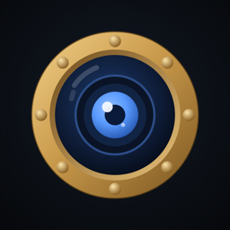
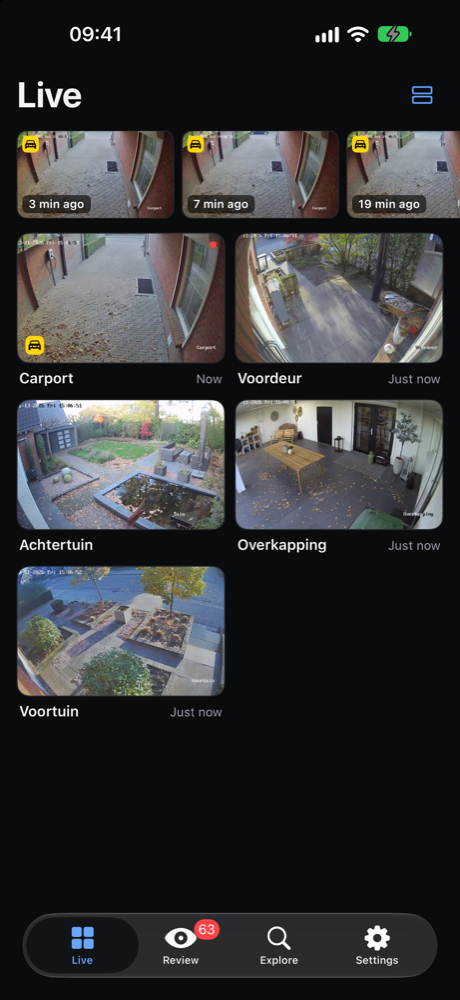
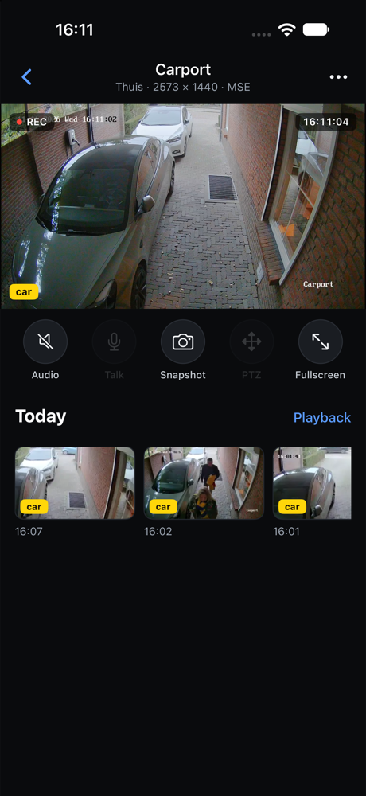
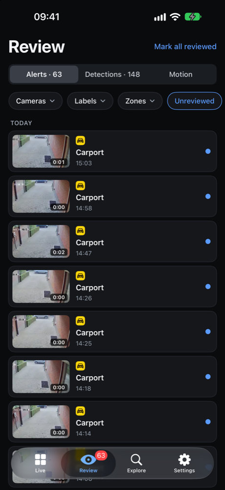
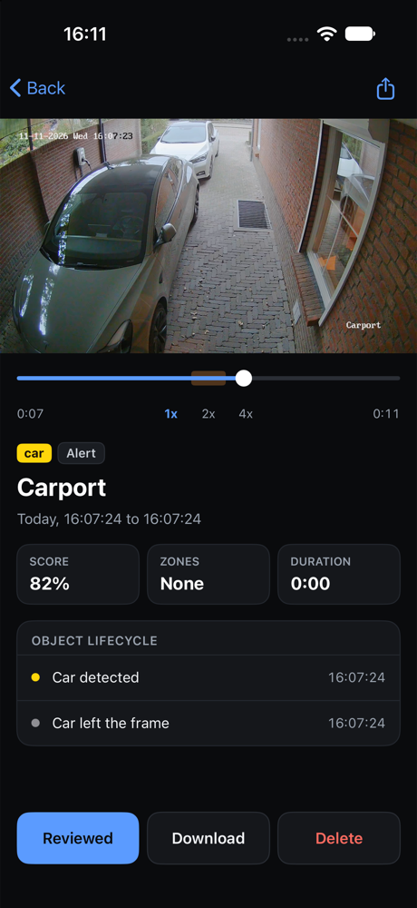
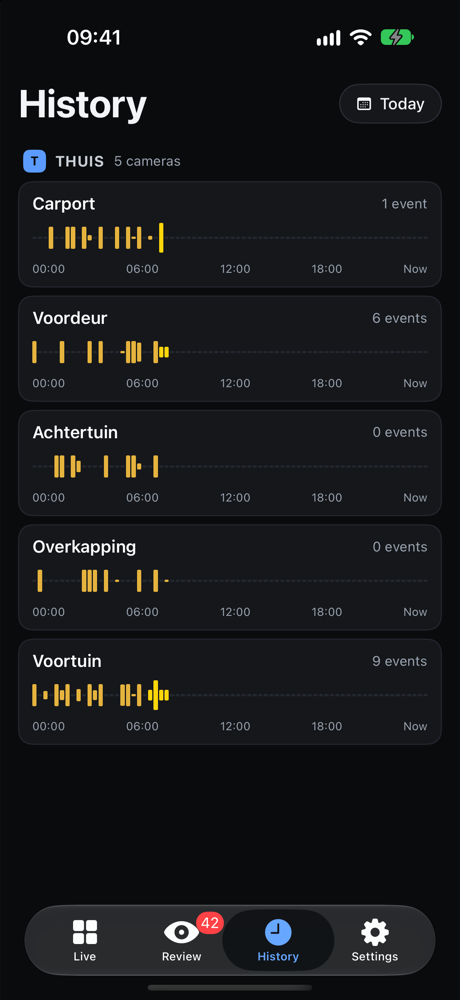
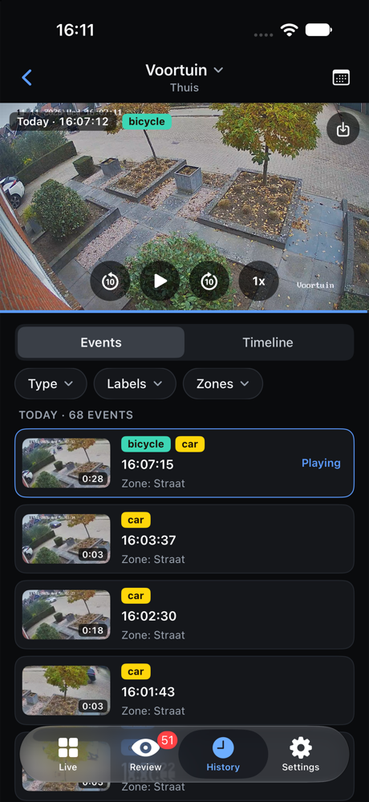
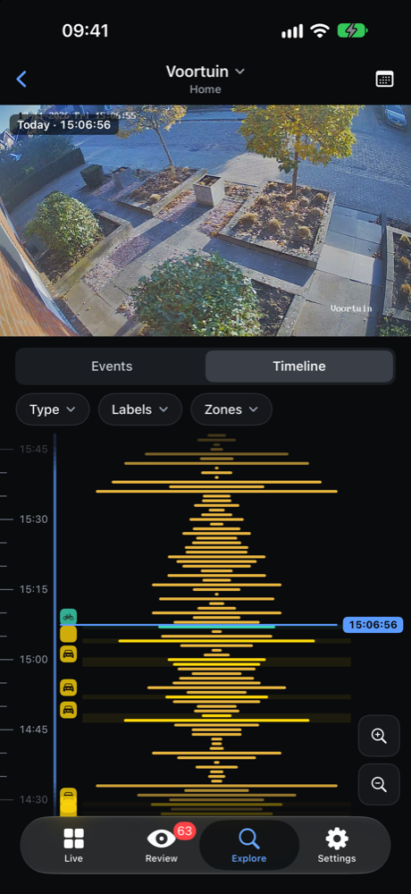
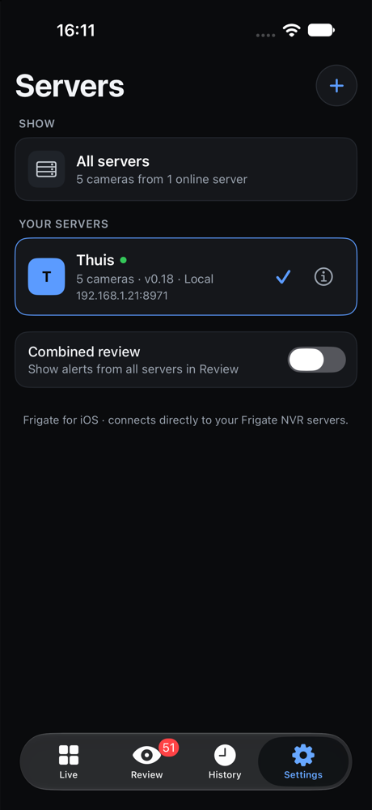
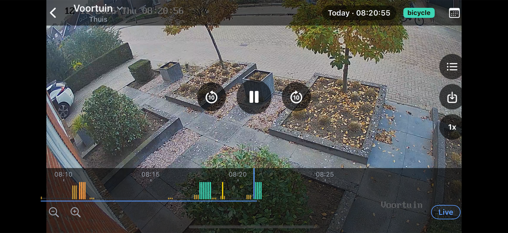

# Tender for Frigate

Native iOS client for [Frigate NVR](https://frigate.video), built from the mockups in `design/`.
Tender is an independent app, compatible with Frigate NVR; it is not affiliated with or endorsed by the Frigate project.
Requires iOS 17 and Xcode 26 or newer. No third-party dependencies.

> **This app is fully vibe coded.** Every line of code, the Xcode project, the TestFlight setup and
> this README were written by an AI coding agent (Claude Code) from the design mockups and plain-language
> feedback, then tested in the iOS Simulator against a real Frigate 0.18 server. No code was written by hand.
> Expect rough edges, and review the code before trusting it with anything important.

## TestFlight

https://testflight.apple.com/join/s6KEWhy1

## Screenshots

<table>
  <tr>
    <td align="center"><br><sub>Live</sub></td>
    <td align="center"><br><sub>Camera</sub></td>
    <td align="center"><br><sub>Review</sub></td>
    <td align="center"><br><sub>Event</sub></td>
  </tr>
  <tr>
    <td align="center"><br><sub>History</sub></td>
    <td align="center"><br><sub>Playback</sub></td>
    <td align="center"><br><sub>Timeline</sub></td>
    <td align="center"><br><sub>Servers</sub></td>
  </tr>
</table>

<p align="center"><br><sub>Landscape playback: tap to hide the overlay, drag the timeline with a live preview</sub></p>

## Run

```bash
open Frigate.xcodeproj
```

Pick an iPhone simulator and run. On first launch the app scans the local network for Frigate
servers (ports 8971 and 5000) and lets you add one. Several servers can be added; in Settings
you choose whether the tabs show one server or all of them.

## Features

| Screen | What it does |
| --- | --- |
| Live | Camera grid with refreshing snapshots, live objects and last activity; red outline while an object moves and a dot for motion (like Frigate's web UI); camera groups from the Frigate config |
| Camera | Live stream through go2rtc (MSE over websocket, WebRTC and MJPEG as fallbacks), audio, snapshot, PTZ (ONVIF cameras), fullscreen, today's events |
| Review | Alerts, detections and motion across servers; filter by server, camera, label and unreviewed; mark reviewed |
| Event | Clip playback with the event range highlighted, 1x/2x/4x, score, zones, object lifecycle, download/share, delete |
| Explore | Tracked objects per label (like Frigate's Explore page), a grid when you pick a label, filters by camera, label, zone, sub label and date, sorting by time or score, object details with snapshot and lifecycle |
| Playback | Recordings per camera and day, event list or scrubbable timeline with zoom and a live preview while dragging (like Frigate's web UI), filters by type, label and zone, gaps shown as "no recording", save an event or a span around the playhead to Photos |
| Landscape | Full-screen live view and playback with an overlay that hides on tap, horizontal timeline and an events panel |
| Everywhere | Pinch to zoom on live and recorded video, swipe back, lighter streams on mobile data, English and Dutch (follows the iPhone language) |
| Chat | Ask Frigate's GenAI chat about your cameras and events, with streamed answers (shown when a server has a GenAI provider with the chat role, Frigate 0.18+) |
| Settings | Servers (add, edit, remove), optional live video in the camera overview |

Credentials are stored in the Keychain. When a username is set the app logs in through
`/api/login`; unauthenticated ports work without one. An optional remote address is used when
the primary address is unreachable.

## Implementation notes

- **Recordings are played in one-hour chunks.** Frigate's `/vod` endpoint returns 503 for ranges
  longer than about three hours. Chunks start on a recording segment boundary so the player
  position maps exactly to wall-clock time (`RecordingMap` in `PlaybackView.swift`).
- **HEVC recordings.** Many cameras deliver H.265 tagged `hev1`, which AVPlayer refuses over HLS.
  `HLSProxy` serves VOD through `127.0.0.1` and rewrites the init segment to `hvc1`; downloaded
  clips get the same patch. This is the same effect as Frigate's `-tag:v hvc1` recording option.
- **Motion activity** is requested per camera: when several cameras are requested at once, Frigate
  merges them into one series.

## Deep links

Useful for testing and shortcuts:

```
frigate://add?url=http://192.168.1.21:8971&name=Home
frigate://live | review | explore | history | chat | settings
frigate://review?view=motion
frigate://camera/<camera>[?server=<name>]
frigate://playback/<camera>[?review=<id>&view=timeline]
frigate://event/<review id>
```

## Not yet implemented

- Two-way audio (Talk button is disabled).
- Push notifications (Frigate notifications need APNs or web push; the "notifications per server"
  toggle from the mockup is left out).

## TestFlight

```bash
scripts/testflight.sh
```

Archives with a timestamp build number, signs with the "Frigate App Store" profile and uploads.
App Store Connect: "Tender for Frigate" (bundle ID `nl.wiebenieuwenhuis.frigate`, team EBTM3728EJ);
the internal group "Intern" gets every build automatically.

## License

Copyright (C) 2026 Wiebe Nieuwenhuis

Tender is free software: you can redistribute it and/or modify it under the terms of the
[GNU General Public License v3.0](LICENSE) as published by the Free Software Foundation.
It is distributed in the hope that it will be useful, but without any warranty.

Frigate is a trademark of Frigate, Inc. Tender is an independent project and is not
affiliated with or endorsed by Frigate.
